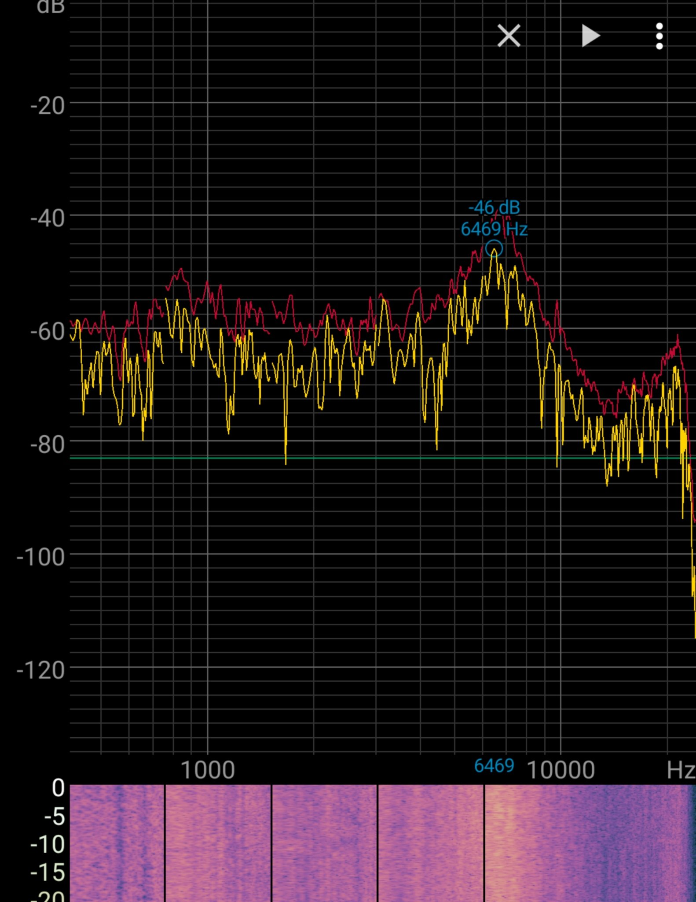
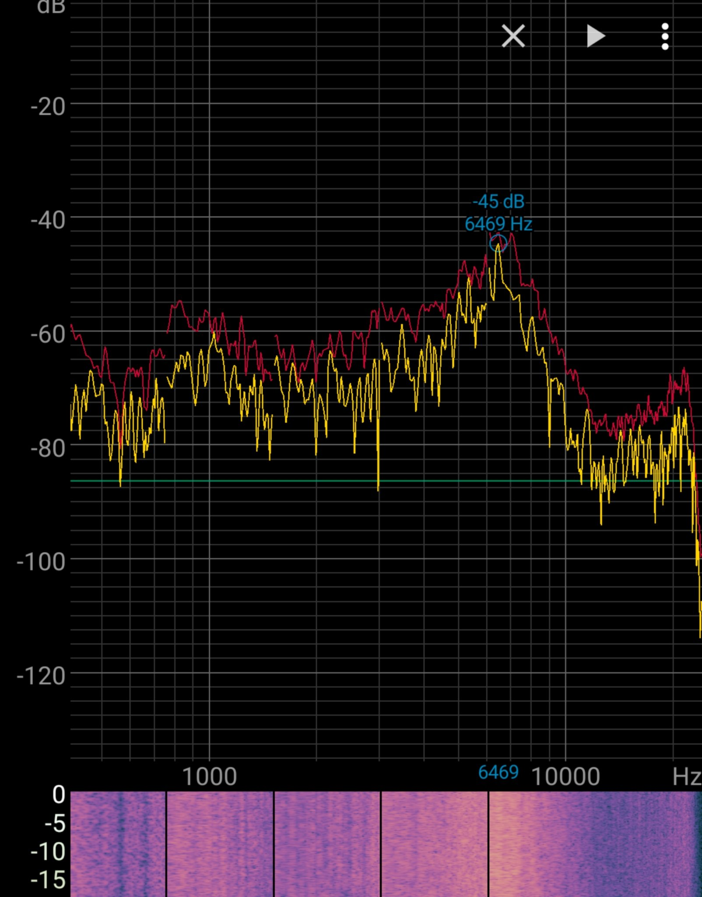

# ThinkBook 14+ EasyEffects Presets
---
Update: this project now uses presets converted from the official Dolby Atoms curves, with 3 flavors available:
- [Dolby Balanced](Dolby-Balanced.json)
- [Dolby Detailed](./Dolby-Detailed.json)
- [Dolby Warm](./Dolby-Warm.json)

Thanks to the work by 
[antoinecellerier/speaker-tuning-to-easyeffects](https://github.com/antoinecellerier/speaker-tuning-to-easyeffects) (v2026.10.1).


```
Lenovo ThinkBook 14 G7+ IAH - 21TK

Realtek ALC257 — Vendor: 0x10EC0257  Codec subsystem: 0x17AA3DD8

Controller subsystem: 17AA:3848
```
---

An attempt to use EasyEffects to improve the sound quality of ThinkBook 14+ (14.5'', 2025)'s internal speaker.


This preset has some aggressive tuning on multiband compressor based on personal preferences:

- Negative makeup in the low-mid range to separate bass and voice. 
- Negative makeup in the high range to suppress some sizzling sounds.
- (Bass Enhancer) Reduce bass because the speaker doesn't perform well in low-frequency range.

Credits:
- Excellent guide on audio tuning - [Enhancing your internal notebook speakers without using an Equalizer - Markus Schmidt](https://jontes.page/misc-static/enhancing-notebook-speakers)
- Presets for various other laptops - [Community Presets](https://github.com/wwmm/easyeffects/wiki/Community-Presets)

## Appendix: Speaker spectrum of ThinkBook 14+
Using EasyEffect's built in white noise test signal generator. Non-professional recording environment for reference only.

| <br>Original audio | <br>EasyEffects preset |
|:---------------------------------:|:------------------------------------:|
